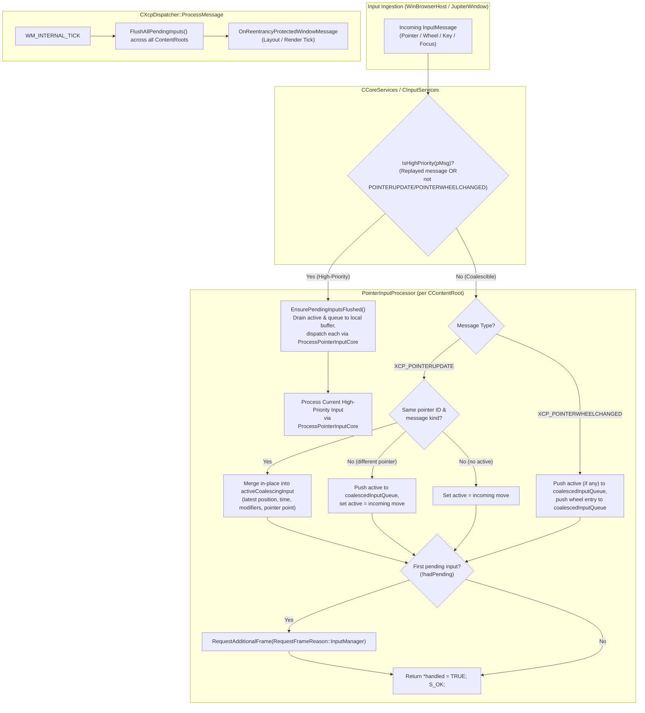

# High-Frequency Input Coalescing Specification & Implementation Plan

## 1. Overview
High-frequency input devices (e.g. 500Hz–1000Hz gaming mice, high-rate pen digitizers) send input packets at rates substantially higher than typical display refresh rates (60Hz–144Hz). Without coalescing, processing every discrete input packet immediately can starve the UI thread for other tasks (such as layout, rendering, data updates, and background dispatcher items).

This feature introduces an input coalescing pipeline in XAML core that:
1. Coalesces consecutive high-frequency pointer updates (`XCP_POINTERUPDATE`) in-place and defers wheel updates (`XCP_POINTERWHEELCHANGED`) in an ordered queue per `CContentRoot`.
2. Preserves chronological interleaving order between different pointers and disparate input messages.
3. Automatically requests a frame render upon receiving the first coalesced input and flushes all pending coalesced events immediately before frame rendering (`WM_INTERNAL_TICK`).
4. Flushes pending inputs immediately before processing any high-priority input (button clicks, pointer down/up, keyboard, focus, activation, replayed messages) to guarantee strict event order.
5. Fully drains the queue during flushes, handling any new events generated synchronously by reentrant message pumps.
6. Preserves the lifetime of platform message packets (`MsgPacket`) and WinRT COM objects (`IPointerPoint`, `IPointerEventArgs`) to ensure full compatibility with Direct Manipulation and XAML routed events.

---

## 2. Architecture & Flow Diagram



---

## 3. Key Principles & Architectural Decisions

### 3.1 Input Event Classification
* **High-Frequency (Coalescible)**:
  * Non-replayed `XCP_POINTERUPDATE`: Merged in-place into `m_activeCoalescingInput` for the same pointer and message kind (overwriting intermediate coordinates, timestamps, modifier keys, physical key status, and pointer references).
  * Non-replayed `XCP_POINTERWHEELCHANGED`: Queued in chronological order in `m_coalescedInputQueue`. Wheel deltas reside immutably inside the OS-created WinRT `ixp::IPointerPointProperties::get_MouseWheelDelta` getter, so wheel events cannot be collapsed without discarding deltas. Buffering and deferring them to the frame tick avoids UI thread saturation while preserving every scroll unit.
* **High-Priority (Immediate Flush Triggers)**:
  * Pointer button state changes: `XCP_POINTERDOWN`, `XCP_POINTERUP`.
  * Pointer boundary/state transitions: `XCP_POINTERENTER`, `XCP_POINTERLEAVE`, `XCP_POINTERCAPTURECHANGED`, `XCP_POINTERSUSPENDED`.
  * Synthetic replayed pointer messages (`m_isReplayedMessage == true`).
  * Keyboard messages: `XCP_KEYDOWN`, `XCP_KEYUP`, `XCP_CHAR`, `XCP_DEADCHAR`.
  * Focus & Window messages: `XCP_GOTFOCUS`, `XCP_LOSTFOCUS`, `XCP_ACTIVATE`, `XCP_DEACTIVATE`, `XCP_WINDOWMOVE`, `XCP_INPUTLANGCHANGE`, `XCP_DMPOINTERHITTEST`.

### 3.2 Platform Handled Status (`handled = TRUE`)
* When an event is coalesced, `*handled = TRUE` is returned **immediately and synchronously** to the OS input site (`InputPointerSource` / `WndProc`).
* This informs Windows that XAML has accepted the event, preventing the OS from synthesizing fallback legacy mouse messages (`WM_MOUSEMOVE`, `WM_LBUTTONDOWN`) or bubbling unhandled events to parent windows.
* App-level event routing (`PointerRoutedEventArgs.Handled`) functions normally when the event is later dispatched inside XAML during flush.

### 3.3 Frame Scheduling
* On the first coalesced input in a content root (`!hadPending`), XAML calls:
  `m_inputManager.m_coreServices.RequestAdditionalFrame(RequestFrameReason::InputManager);`
* This requests a frame from the compositor, ensuring a `WM_INTERNAL_TICK` will be posted to the UI thread dispatcher message queue to drive the flush before the frame renders.

### 3.4 Flushing Hooks
Flushing occurs at three precise moments:
1. **Before any high-priority pointer event**: handled directly in `PointerInputProcessor::ProcessPointerInput`.
2. **Before any other high-priority input (keyboard, focus, window)**: handled in `CInputServices::ProcessInput` via `contentRoot->GetInputManager().EnsurePendingInputsFlushed()`.
3. **Before frame rendering**: in `CXcpDispatcher::ProcessMessage`, on `WM_INTERNAL_TICK`, calling `m_pBH->GetContextInterface()->FlushAllPendingInputs()` *before* invoking `OnReentrancyProtectedWindowMessage`.

### 3.5 Complete Draining with Reentrancy Protection
* `EnsurePendingInputsFlushed()` guards against reentrant flush calls via `m_isFlushing`.
* A `while (HasPendingInput() && drainPasses++ < maxDrainPasses)` drain loop transfers any active input and all queued entries (`std::move(m_coalescedInputQueue)`) to a local buffer each iteration.
* Any new events that arrive while dispatching the batch (e.g., if an event handler invokes a modal dialog or nested message pump like `MessageBox` or `Dispatcher.PushFrame`) are queued into the member queue and subsequently drained by the next pass of the `while` loop before `EnsurePendingInputsFlushed()` returns.

### 3.6 Lifetime Preservation of Platform & COM Objects
* In synchronous processing, `MsgPacket` was allocated on the stack in `JupiterControl::HandlePointerMessage`, and `pMsg->m_hPlatformPacket` pointed to this stack variable.
* When input is deferred to the frame tick, the stack frame returns immediately. To prevent dangling pointers:
  * `CoalescedInputEntry` stores a `std::shared_ptr<MsgPacket>` holding a heap copy of the packet, and updates `m_msg.m_hPlatformPacket` to point to it.
  * `CoalescedInputEntry` stores `wrl::ComPtr<ixp::IPointerPoint>` and `wrl::ComPtr<ixp::IPointerEventArgs>`, keeping the WinRT objects alive and valid until dispatched.
* When `ProcessPointerInputCore` dispatches `XCP_POINTERWHEELCHANGED`, Direct Manipulation (`CInputServices::ProcessInputMessageWithDirectManipulation`) validates `FAIL_FAST_ASSERT(currentMsg->m_hPlatformPacket)` and extracts the reconstructed Win32 `MSG` without dangling pointer crashes.

---

## 4. Implementation Details

### 4.1 Data Structures in `PointerInputProcessor.h`
```cpp
struct MsgPacket; // Forward declaration keeps header decoupled from winpal.h

namespace ContentRootInput
{
    struct CoalescedInputEntry
    {
        CoalescedInputEntry() = default;
        explicit CoalescedInputEntry(const InputMessage& msg);

        InputMessage m_msg{};
        wrl::ComPtr<ixp::IPointerPoint> m_spPointerPoint;
        wrl::ComPtr<ixp::IPointerEventArgs> m_spPointerEventArgs;
        std::shared_ptr<MsgPacket> m_spMsgPacket;
    };

    class PointerInputProcessor
    {
    public:
        PointerInputProcessor(_In_ CInputManager& inputManager);

        bool HasPendingInput() const;
        _Check_return_ HRESULT EnsurePendingInputsFlushed();
        static bool IsHighPriority(_In_ const InputMessage* pMsg);

        _Check_return_ HRESULT ProcessPointerInput(
            _In_ InputMessage *pMsg,
            _Out_ XINT32 *handled);

        _Check_return_ HRESULT ProcessPointerInputCore(
            _In_ InputMessage *pMsg,
            _Out_ XINT32 *handled);

    private:
        std::optional<CoalescedInputEntry> m_activeCoalescingInput;
        std::vector<CoalescedInputEntry> m_coalescedInputQueue;
        bool m_isFlushing = false;
    };
}
```

### 4.2 Helper & Construction Logic in `PointerInputProcessor.cpp`
```cpp
CoalescedInputEntry::CoalescedInputEntry(const InputMessage& msg)
    : m_msg(msg)
    , m_spPointerPoint(msg.m_pPointerPointNoRef)
    , m_spPointerEventArgs(msg.m_pPointerEventArgsNoRef)
{
    if (msg.m_hPlatformPacket)
    {
        m_spMsgPacket = std::make_shared<MsgPacket>(*static_cast<const MsgPacket*>(msg.m_hPlatformPacket));
        m_msg.m_hPlatformPacket = m_spMsgPacket.get();
    }
}

/* static */ bool PointerInputProcessor::IsHighPriority(_In_ const InputMessage* pMsg)
{
    return pMsg->IsReplayedMessage()
        || (pMsg->m_msgID != XCP_POINTERUPDATE && pMsg->m_msgID != XCP_POINTERWHEELCHANGED);
}
```

### 4.3 Coalescing Implementation in `PointerInputProcessor::ProcessPointerInput`
```cpp
_Check_return_ HRESULT PointerInputProcessor::ProcessPointerInput(
    _In_ InputMessage *pMsg,
    _Out_ XINT32 *handled)
{
    IFCPTR_RETURN(pMsg);
    IFCPTR_RETURN(handled);

    if (IsHighPriority(pMsg))
    {
        IFC_RETURN(EnsurePendingInputsFlushed());
        return ProcessPointerInputCore(pMsg, handled);
    }

    const auto hadPending = HasPendingInput();

    if (pMsg->m_msgID == XCP_POINTERUPDATE)
    {
        if (m_activeCoalescingInput.has_value())
        {
            auto& active = *m_activeCoalescingInput;
            const auto isSameMsgKind = (active.m_msg.m_msgID == pMsg->m_msgID) && (active.m_msg.m_bIsSecondaryMessage == pMsg->m_bIsSecondaryMessage);
            const auto isSamePointer = (active.m_msg.m_pointerInfo.m_pointerId == pMsg->m_pointerInfo.m_pointerId);
            const auto canCoalesceWithPreviousInput = isSameMsgKind && isSamePointer;

            if (!canCoalesceWithPreviousInput)
            {
                m_coalescedInputQueue.push_back(std::move(active));
            }
        }
        m_activeCoalescingInput = CoalescedInputEntry(*pMsg);
    }
    else // XCP_POINTERWHEELCHANGED
    {
        if (m_activeCoalescingInput.has_value())
        {
            m_coalescedInputQueue.push_back(std::move(*m_activeCoalescingInput));
            m_activeCoalescingInput.reset();
        }

        m_coalescedInputQueue.push_back(CoalescedInputEntry(*pMsg));
    }

    if (!hadPending)
    {
        m_inputManager.m_coreServices.RequestAdditionalFrame(RequestFrameReason::InputManager);
    }

    if (pMsg->m_pointerInfo.m_pointerInputType == XcpPointerInputTypeMouse)
    {
        m_inputManager.SetLastInputDeviceType(DirectUI::InputDeviceType::Mouse);
    }
    else if (pMsg->m_pointerInfo.m_pointerInputType == XcpPointerInputTypeTouch)
    {
        m_inputManager.SetLastInputDeviceType(DirectUI::InputDeviceType::Touch);
    }
    else if (pMsg->m_pointerInfo.m_pointerInputType == XcpPointerInputTypePen)
    {
        m_inputManager.SetLastInputDeviceType(DirectUI::InputDeviceType::Pen);
    }

    *handled = TRUE;
    return S_OK;
}
```

### 4.4 Draining Loop in `PointerInputProcessor::EnsurePendingInputsFlushed`
```cpp
_Check_return_ HRESULT PointerInputProcessor::EnsurePendingInputsFlushed()
{
    if (m_isFlushing)
    {
        return S_OK;
    }

    auto flushGuard = wil::scope_exit([&] { m_isFlushing = false; });
    m_isFlushing = true;

    size_t drainPasses = 0;
    constexpr size_t maxDrainPasses = 100;

    while (HasPendingInput() && drainPasses++ < maxDrainPasses)
    {
        if (m_activeCoalescingInput.has_value())
        {
            m_coalescedInputQueue.push_back(std::move(*m_activeCoalescingInput));
            m_activeCoalescingInput.reset();
        }

        auto toFlush = std::move(m_coalescedInputQueue);
        m_coalescedInputQueue.clear();

        for (auto& entry : toFlush)
        {
            XINT32 coreHandled = FALSE;
            IGNOREHR(ProcessPointerInputCore(&entry.m_msg, &coreHandled));
        }
    }

    return S_OK;
}
```

### 4.5 Direct Manipulation Integration
During `ProcessPointerInputCore` for `XCP_POINTERWHEELCHANGED`:
1. `m_pCurrentMsgForDirectManipulationProcessing` is set to point to the active `InputMessage`.
2. `EventManager->RaiseRoutedEvent(UIElement_PointerWheelChanged)` is raised synchronously.
3. `ScrollViewer::OnPointerWheelChanged` intercepts the event, calling `ProcessPureInertiaInputMessage`.
4. `CInputServices::ProcessInputMessageWithDirectManipulation` reads the current message via `contentRoot->GetInputManager().GetCurrentMsgForDirectManipulationProcessing()`.
5. It verifies `FAIL_FAST_ASSERT(currentMsg->m_hPlatformPacket)` and invokes `pDirectManipulationService->ProcessInput`, which unpacks the heap `MsgPacket`'s `m_wParam` and `m_lParam` to feed the Direct Manipulation viewport.
6. A scope guard resets `m_pCurrentMsgForDirectManipulationProcessing = nullptr` upon exit from `RaiseRoutedEvent`.

### 4.6 Global Exposure & Hook Points
1. **`CInputManager` (`InputManager.h`)**:
   * Exposes inline forwarders `HasPendingInput()` and `EnsurePendingInputsFlushed()` calling `m_pointerInputProcessor`.
2. **`CInputServices::ProcessInput` (`InputServices.cpp`)**:
   * Invocations of `contentRoot->GetInputManager().EnsurePendingInputsFlushed()` before handling non-pointer high-priority messages (`XCP_DEACTIVATE`, `XCP_ACTIVATE`, `XCP_DMPOINTERHITTEST`, `XCP_KEYUP`, `XCP_KEYDOWN`, `XCP_CHAR`, `XCP_DEADCHAR`, `XCP_GOTFOCUS`, `XCP_LOSTFOCUS`, `XCP_CONTEXTMENU`, `XCP_INPUTLANGCHANGE`, `XCP_WINDOWMOVE`).
3. **`CCoreServices::FlushAllPendingInputs()` (`corep.h`, `xcpcore.cpp`, `CoreServicesStub.cpp`)**:
   * Iterates through `m_contentRootCoordinator.GetContentRoots()` and calls `EnsurePendingInputsFlushed()` on each root.
4. **`CXcpDispatcher::ProcessMessage` (`xcpwindow.cpp`)**:
   * On `case WM_INTERNAL_TICK:`, calls `m_pBH->GetContextInterface()->FlushAllPendingInputs()` before invoking `OnReentrancyProtectedWindowMessage`.
