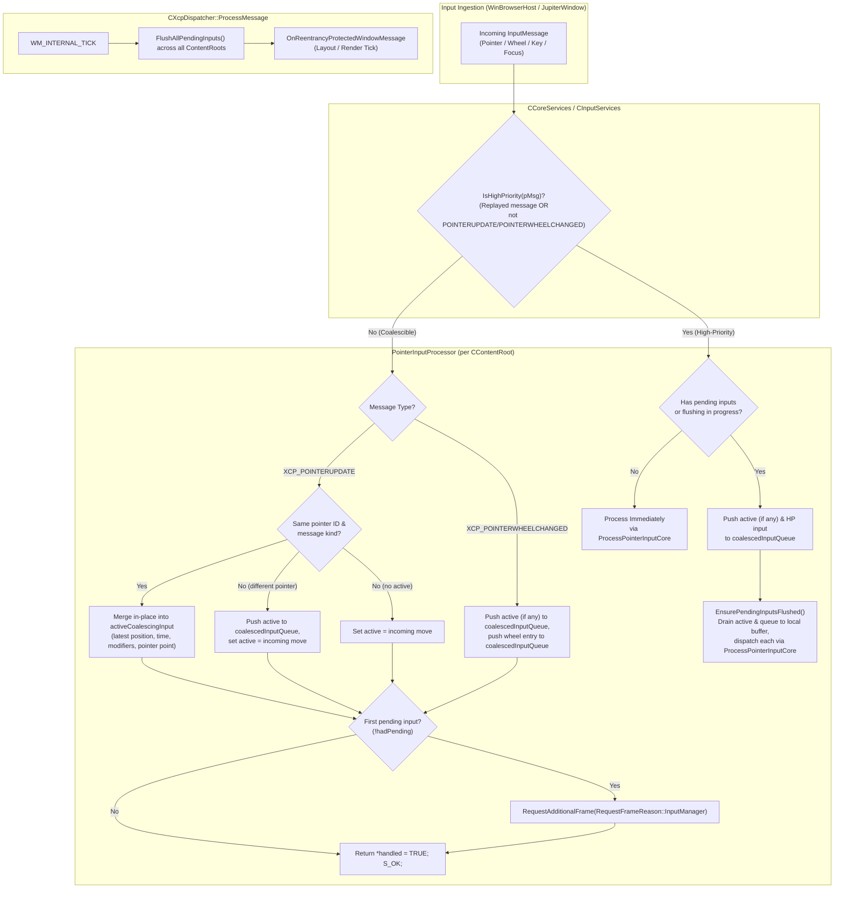

# High-Frequency Input Coalescing Specification & Implementation Plan

## 1. Overview
High-frequency input devices (e.g. 500Hz–1000Hz gaming mice, high-rate pen digitizers) send input packets at rates substantially higher than typical display refresh rates (60Hz–144Hz). Without coalescing, processing every discrete input packet immediately can starve the UI thread for other tasks (such as layout, rendering, data updates, and background dispatcher items).

This feature introduces an input coalescing pipeline in XAML core that:
1. Coalesces consecutive high-frequency pointer updates (`XCP_POINTERUPDATE`) in-place and defers wheel updates (`XCP_POINTERWHEELCHANGED`) in an ordered queue per `CContentRoot`.
2. Preserves chronological interleaving order between different pointers and disparate input messages.
3. Automatically requests a frame render upon receiving the first coalesced input and flushes all pending coalesced events immediately before frame rendering (`WM_INTERNAL_TICK`).
4. Immediately handles high-priority input (pointer down/up, replayed messages) if no pending inputs exist; if pending inputs exist or a flush is in progress, queues the high-priority input and flushes the queue, guaranteeing that new events arriving during flushing are queued and drained in the same pass.
5. Fully drains the queue during flushes, handling any new events generated synchronously by reentrant message pumps.
6. Preserves the lifetime of platform message packets (`MsgPacket`) and WinRT COM objects (`IPointerPoint`, `IPointerEventArgs`) to ensure full compatibility with Direct Manipulation and XAML routed events.

---

## 2. Architecture & Flow Diagram

---

## 3. Key Principles & Architectural Decisions

### 3.1 Input Event Classification
* **High-Frequency (Coalescible)**:
  * Non-replayed `XCP_POINTERUPDATE`: Merged in-place into `m_activeCoalescingInput` for the same pointer and message kind (overwriting intermediate coordinates, timestamps, modifier keys, physical key status, and pointer references).
  * Non-replayed `XCP_POINTERWHEELCHANGED`: Queued in chronological order in `m_coalescedInputQueue`. Wheel deltas reside immutably inside the OS-created WinRT `ixp::IPointerPointProperties::get_MouseWheelDelta` getter, so wheel events cannot be collapsed without discarding deltas. Buffering and deferring them to the frame tick avoids UI thread saturation while preserving every scroll unit.
* **High-Priority (Immediate Flush Triggers)**:
  * Pointer button state changes: `XCP_POINTERDOWN`, `XCP_POINTERUP`.
  * Pointer boundary/state transitions: `XCP_POINTERENTER`, `XCP_POINTERLEAVE`, `XCP_POINTERCAPTURECHANGED`, `XCP_POINTERSUSPENDED`.
  * Synthetic replayed pointer messages (`m_isReplayedMessage == true`).
  * Keyboard messages: `XCP_KEYDOWN`, `XCP_KEYUP`, `XCP_CHAR`, `XCP_DEADCHAR`.
  * Focus & Window messages: `XCP_GOTFOCUS`, `XCP_LOSTFOCUS`, `XCP_ACTIVATE`, `XCP_DEACTIVATE`, `XCP_WINDOWMOVE`, `XCP_INPUTLANGCHANGE`, `XCP_DMPOINTERHITTEST`.

### 3.2 Platform Handled Status (`handled = TRUE`)
* When an event is coalesced, `*handled = TRUE` is returned **immediately and synchronously** to the OS input site (`InputPointerSource` / `WndProc`).
* This informs Windows that XAML has accepted the event, preventing the OS from synthesizing fallback legacy mouse messages (`WM_MOUSEMOVE`, `WM_LBUTTONDOWN`) or bubbling unhandled events to parent windows.
* App-level event routing (`PointerRoutedEventArgs.Handled`) functions normally when the event is later dispatched inside XAML during flush.

### 3.3 Frame Scheduling
* On the first coalesced input in a content root (`!hadPending`), XAML calls:
  `m_inputManager.m_coreServices.RequestAdditionalFrame(RequestFrameReason::InputManager);`
* This requests a frame from the compositor, ensuring a `WM_INTERNAL_TICK` will be posted to the UI thread dispatcher message queue to drive the flush before the frame renders.

### 3.4 Flushing Hooks
Flushing occurs at three precise moments:
1. **On high-priority pointer events**: in `PointerInputProcessor::ProcessPointerInput`, if no inputs are pending and no flush is in progress, high-priority events are processed immediately via `ProcessPointerInputCore`. If pending inputs exist or a flush is actively in progress, the high-priority input is pushed into `m_coalescedInputQueue` (after committing any `m_activeCoalescingInput`) and `EnsurePendingInputsFlushed()` is called, ensuring that prior events are drained first and any new events arriving during flushing are queued and processed in the same pass.
2. **Before any other high-priority input (keyboard, focus, window)**: handled in `CInputServices::ProcessInput` via `contentRoot->GetInputManager().EnsurePendingInputsFlushed()`.
3. **Before frame rendering**: in `CXcpDispatcher::ProcessMessage`, on `WM_INTERNAL_TICK`, calling `m_pBH->GetContextInterface()->FlushAllPendingInputs()` *before* invoking `OnReentrancyProtectedWindowMessage`.

### 3.5 Complete Draining in a Single Loop with Reentrancy Protection
* `EnsurePendingInputsFlushed()` guards against reentrant flush calls via `m_isFlushing`.
* A single `while (HasPendingInput())` loop completely drains the queue by popping each entry (`m_coalescedInputQueue.pop_front()`) and dispatching it via `ProcessPointerInputCore`.
* If `m_coalescedInputQueue` is empty but `m_activeCoalescingInput` has an uncommitted move, it is moved into the queue and dispatched next.
* Any new events that arrive while dispatching an event (e.g., if an event handler invokes a modal dialog or nested message pump like `MessageBox` or `Dispatcher.PushFrame`) are appended to `m_coalescedInputQueue` or merged into `m_activeCoalescingInput`. The single loop continues iterating until both are fully drained before `EnsurePendingInputsFlushed()` returns.

### 3.6 Lifetime Preservation of Platform & COM Objects
* In synchronous processing, `MsgPacket` was allocated on the stack in `JupiterControl::HandlePointerMessage`, and `pMsg->m_hPlatformPacket` pointed to this stack variable.
* When input is deferred to the frame tick, the stack frame returns immediately. To prevent dangling pointers:
  * `CoalescedInputEntry` stores a `std::shared_ptr<MsgPacket>` holding a heap copy of the packet, and updates `m_msg.m_hPlatformPacket` to point to it.
  * `CoalescedInputEntry` stores `wrl::ComPtr<ixp::IPointerPoint>` and `wrl::ComPtr<ixp::IPointerEventArgs>`, keeping the WinRT objects alive and valid until dispatched.
* When `ProcessPointerInputCore` dispatches `XCP_POINTERWHEELCHANGED`, Direct Manipulation (`CInputServices::ProcessInputMessageWithDirectManipulation`) validates `FAIL_FAST_ASSERT(currentMsg->m_hPlatformPacket)` and extracts the reconstructed Win32 `MSG` without dangling pointer crashes.

---

## 4. Implementation Details

### 4.1 Data Structures (`PointerInputProcessor.h`)
* **`CoalescedInputEntry`**: Encapsulates a deferred input message along with lifetime-extended references:
  * `InputMessage m_msg`: The copied input message data.
  * `wrl::ComPtr<ixp::IPointerPoint> m_spPointerPoint`: Strong reference to the WinRT pointer point object.
  * `wrl::ComPtr<ixp::IPointerEventArgs> m_spPointerEventArgs`: Strong reference to the WinRT pointer event arguments.
  * `std::shared_ptr<MsgPacket> m_spMsgPacket`: Heap-allocated copy of the platform packet to prevent dangling pointer references once the ingestion stack frame exits.
* **`PointerInputProcessor` State**:
  * `std::optional<CoalescedInputEntry> m_activeCoalescingInput`: Holds the most recent coalescible pointer move (`XCP_POINTERUPDATE`) for in-place merging.
  * `std::deque<CoalescedInputEntry> m_coalescedInputQueue`: Ordered FIFO queue for chronological interleaving of deferred events (moves, wheel turns, and queued high-priority events).
  * `bool m_isFlushing`: Guard flag preventing reentrant flushes while events are being dispatched.

### 4.2 Helper & Classification Logic
* **`CoalescedInputEntry` Construction**:
  * Copies the input message and acquires strong COM references to the pointer point and event arguments.
  * Clones any stack-allocated platform `MsgPacket` onto the heap via `std::make_shared` and re-points `m_msg.m_hPlatformPacket` to the heap copy.
* **`PointerInputProcessor::IsHighPriority`**:
  * Classifies an input message as high priority if it is a synthetic replayed message or any message type other than `XCP_POINTERUPDATE` and `XCP_POINTERWHEELCHANGED` (e.g. pointer pressed/released, enter/leave, capture changes).

### 4.3 Ingestion Pipeline (`PointerInputProcessor::ProcessPointerInput`)
* **High-Priority Inputs**:
  * If no inputs are pending and no flush is active, immediately processes the event synchronously via `ProcessPointerInputCore`.
  * If pending inputs exist or a flush is currently in progress, commits any active coalescing move into `m_coalescedInputQueue`, appends the high-priority input to the queue, and calls `EnsurePendingInputsFlushed()`.
* **Coalescible Pointer Moves (`XCP_POINTERUPDATE`)**:
  * Evaluates whether the incoming move can coalesce with `m_activeCoalescingInput` (matching pointer ID and secondary message status).
  * If coalescible, merges the move in-place by overwriting coordinates, modifier keys, physical key state, and references.
  * If not coalescible (different pointer ID or message type), pushes the existing active input to `m_coalescedInputQueue` and stores the incoming move as the new active input.
* **Coalescible Pointer Wheel (`XCP_POINTERWHEELCHANGED`)**:
  * Commits any active coalescing move to `m_coalescedInputQueue`.
  * Appends the wheel event to `m_coalescedInputQueue` (preserving individual wheel delta packets).
* **Frame Request & Device Tracking**:
  * On the first deferred input, schedules a frame render tick via `RequestAdditionalFrame(RequestFrameReason::InputManager)`.
  * Updates the last input device type on `CInputManager`.
  * Synchronously returns `*handled = TRUE` to the platform so the OS does not bubble or synthesize fallback mouse messages.

### 4.4 Draining Pipeline (`PointerInputProcessor::EnsurePendingInputsFlushed`)
* **Reentrancy Protection**: Uses `m_isFlushing` with a scope guard to prevent nested reentrant flush invocations.
* **Single-Loop Complete Draining**:
  * Executes a single `while (HasPendingInput())` loop.
  * When `m_coalescedInputQueue` is empty, commits any remaining `m_activeCoalescingInput` into the queue.
  * Pops the front entry from `m_coalescedInputQueue` and dispatches it via `ProcessPointerInputCore`.
  * Any new events arriving synchronously during dispatch (e.g. from nested message pumps spun by event handlers) are appended to `m_coalescedInputQueue` or merged into `m_activeCoalescingInput`, and subsequently drained by the same loop before returning.

### 4.5 Direct Manipulation Integration
During `ProcessPointerInputCore` for `XCP_POINTERWHEELCHANGED`:
1. `m_pCurrentMsgForDirectManipulationProcessing` is set to point to the active `InputMessage`.
2. `EventManager->RaiseRoutedEvent(UIElement_PointerWheelChanged)` is raised synchronously.
3. `ScrollViewer::OnPointerWheelChanged` intercepts the event, calling `ProcessPureInertiaInputMessage`.
4. `CInputServices::ProcessInputMessageWithDirectManipulation` reads the current message via `contentRoot->GetInputManager().GetCurrentMsgForDirectManipulationProcessing()`.
5. It verifies `FAIL_FAST_ASSERT(currentMsg->m_hPlatformPacket)` and invokes `pDirectManipulationService->ProcessInput`, which unpacks the heap `MsgPacket`'s `m_wParam` and `m_lParam` to feed the Direct Manipulation viewport.
6. A scope guard resets `m_pCurrentMsgForDirectManipulationProcessing = nullptr` upon exit from `RaiseRoutedEvent`.

### 4.6 Global Exposure & Hook Points
1. **`CInputManager` (`InputManager.h`)**:
   * Exposes inline forwarders `HasPendingInput()` and `EnsurePendingInputsFlushed()` calling `m_pointerInputProcessor`.
2. **`CInputServices::ProcessInput` (`InputServices.cpp`)**:
   * Invocations of `contentRoot->GetInputManager().EnsurePendingInputsFlushed()` before handling non-pointer high-priority messages (`XCP_DEACTIVATE`, `XCP_ACTIVATE`, `XCP_DMPOINTERHITTEST`, `XCP_KEYUP`, `XCP_KEYDOWN`, `XCP_CHAR`, `XCP_DEADCHAR`, `XCP_GOTFOCUS`, `XCP_LOSTFOCUS`, `XCP_CONTEXTMENU`, `XCP_INPUTLANGCHANGE`, `XCP_WINDOWMOVE`).
3. **`CCoreServices::FlushAllPendingInputs()` (`corep.h`, `xcpcore.cpp`, `CoreServicesStub.cpp`)**:
   * Iterates through `m_contentRootCoordinator.GetContentRoots()` and calls `EnsurePendingInputsFlushed()` on each root.
4. **`CXcpDispatcher::ProcessMessage` (`xcpwindow.cpp`)**:
   * On `case WM_INTERNAL_TICK:`, calls `m_pBH->GetContextInterface()->FlushAllPendingInputs()` before invoking `OnReentrancyProtectedWindowMessage`.
